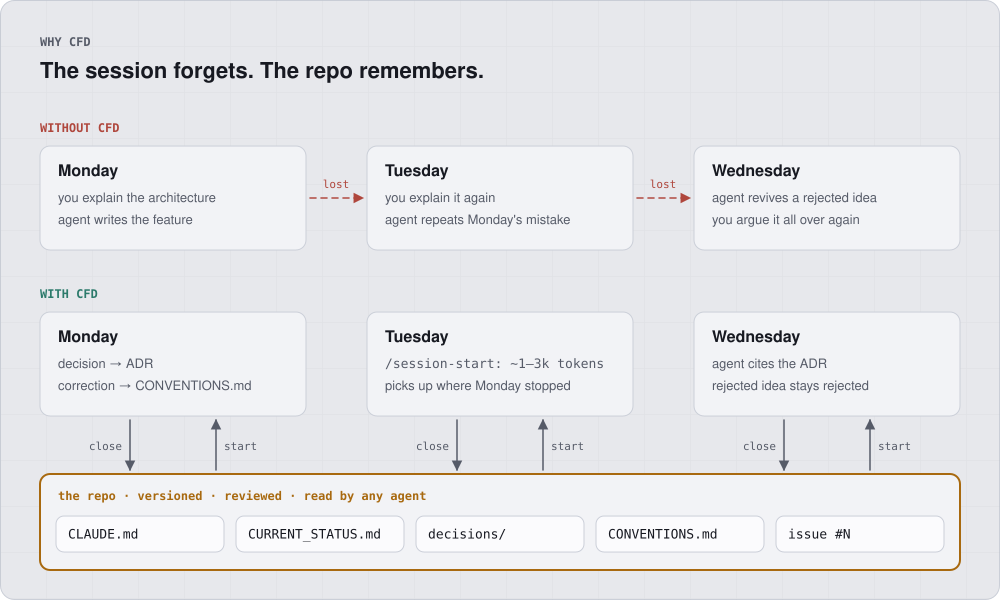
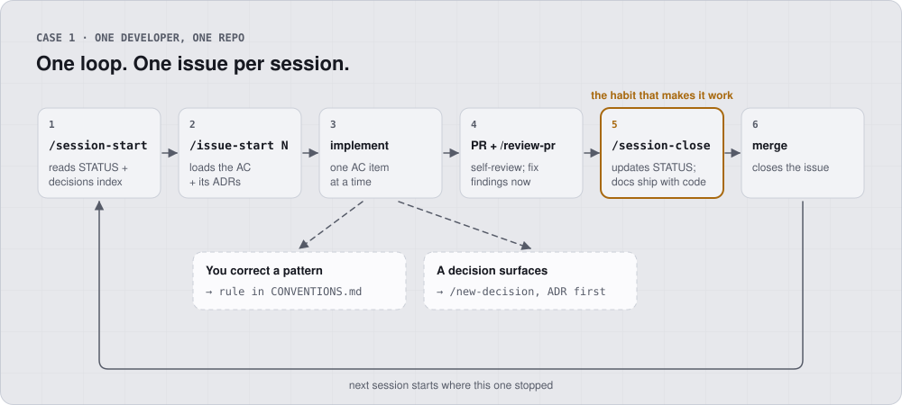
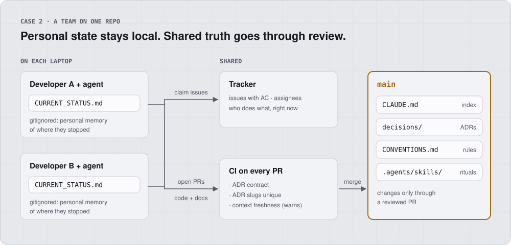
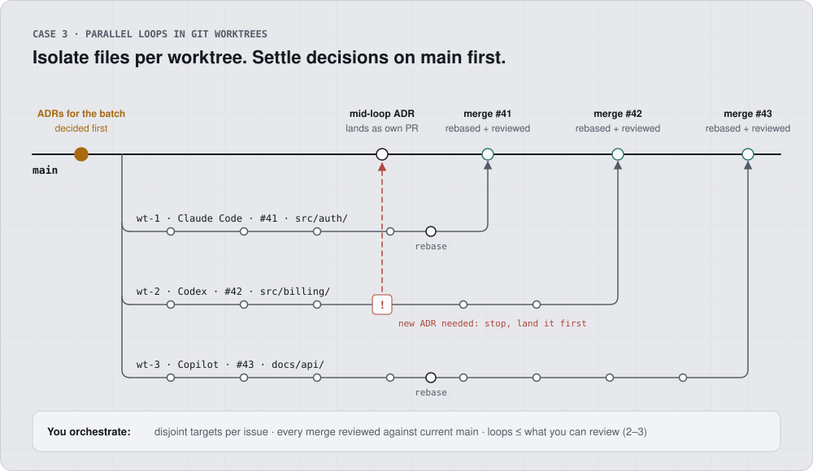
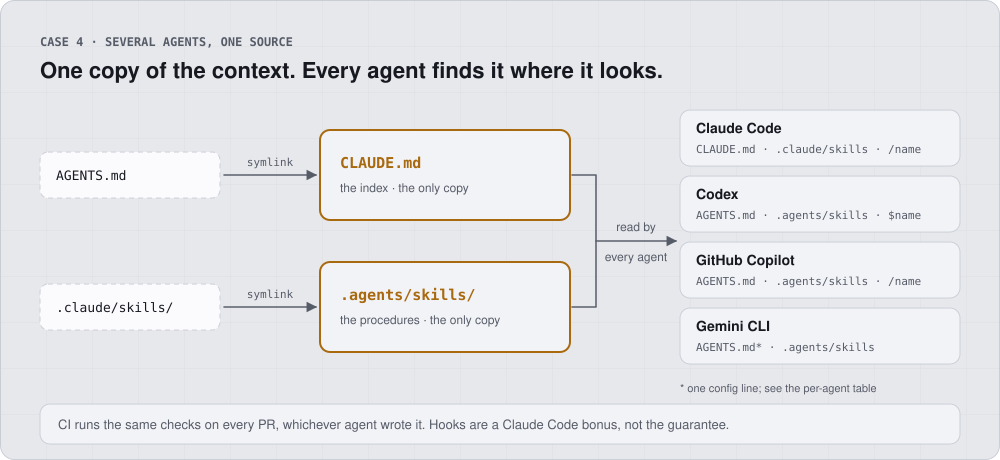

# Context-First Development

[](https://github.com/albertomarturelo/context-first-development/actions/workflows/validate-catalog.yml)

> Your AI agent has amnesia at the start of every session. CFD is the cure.

**CFD is a methodology for engineers who use AI coding agents** (Claude
Code, Gemini CLI, Codex, Cursor, Aider) **on real repositories.** It treats
context as a first-class artifact: structured, versioned, and reviewed like
code.

<picture>
  <source media="(prefers-color-scheme: dark)" srcset="docs/diagrams/how-it-works-dark.svg">
  
</picture>

**The primary payoff is adherence, not tokens**: code that respects your
conventions on the first attempt, decisions that don't get re-litigated,
corrections that never repeat. Token savings are a welcome side effect —
orientation drops to a few thousand tokens — but if you adopt CFD to
save tokens you're optimizing the wrong variable. Modern agents don't
naively scan whole repos; they search. What they *can't* search is the
**why**: the rejected alternatives, the conventions, the in-flight state.
That is what CFD persists.

**Evidence.** Measure the ceiling on your own project with
[`scripts/measure-session-cost.sh`](scripts/measure-session-cost.sh):
it compares a CFD-style `/session-start` (reading the `CLAUDE.md` +
`CURRENT_STATUS.md` + decisions-index triad) against reading every
file — an **upper bound**, since a real agent explores selectively.
The honest per-session metrics (re-explanation rate,
time-to-first-correct-action) are defined in the methodology essay's
Metrics section; measure those on real sessions.

Real-world adopter you can click through:
**[`sii`](case-studies/sii.md)** — a TypeScript monorepo (shared core
+ CLI + MCP server for Chile's tax authority) **born with CFD on
day 0**: ADR-001 is the adoption decision, 21 ADRs landed in the first
week, `CLAUDE.md`'s Critical Rules cite their backing ADRs by number,
and the packages ship on public npm under MIT. A team case study from
Equifax (ID Watchdog Mobile) is in progress; see
[`case-studies/`](case-studies/).

## The 30-second pitch

|                        | Without CFD                                 | With CFD                                                          |
| ---------------------- | ------------------------------------------- | ----------------------------------------------------------------- |
| Session start          | Agent re-explores the repo every session (search + targeted reads, and still no "why") | 500–1,500 tokens reading `CLAUDE.md` + `CURRENT_STATUS.md`        |
| Architectural context  | Lives in your head, re-explained each time  | Lives in `docs/decisions/` ADRs the agent reads automatically     |
| Agent's wrong patterns | Manually fixed every session                | Convention documented once; agent reads it next session           |
| Project state          | Lives in your memory                        | `docs/CURRENT_STATUS.md` is the project's running session log     |
| Hallucination surface  | Wide — agent invents details to fill blanks | Narrow — explicit ADRs constrain what is decided vs. open         |
| Multi-model            | Locks you in to whichever tool you tried    | Plain Markdown; works with any agent that reads context files     |

## CFD in your setup

The files and the loop are the same everywhere. What changes with your
setup is **where state lives** and **who has to agree before a decision
lands**. Find yours:

| Your setup                              | What changes                                              | Read            |
| --------------------------------------- | --------------------------------------------------------- | --------------- |
| One developer, one repo                 | Nothing extra: the loop below                             | [Case 1](#case-1--one-developer-one-repo) |
| A team on one repo                      | Status file leaves git; the tracker says who does what    | [Case 2](#case-2--a-team-on-one-repo) |
| Several agents in parallel (worktrees)  | Decisions land on `main` first; merges go one at a time   | [Case 3](#case-3--parallel-loops-in-git-worktrees) |
| Mixed agents (Claude, Codex, Copilot…)  | Nothing to translate: one copy, symlinked                 | [Case 4](#case-4--several-agents-one-source) |

The cases stack: a team running Codex and Claude in worktrees reads all
four.

### Case 1 · One developer, one repo

<picture>
  <source media="(prefers-color-scheme: dark)" srcset="docs/diagrams/case-solo-dark.svg">
  
</picture>

- **One issue per session.** `/issue-new` forces decomposition until an
  issue fits one session; the issue body is the spec.
- **Write it down when it happens.** Correct a pattern once and it goes
  into `CONVENTIONS.md`; make a decision and it becomes an ADR *before*
  the code. The agent never hears the same correction twice.
- **Review yourself before you close.** Run `/review-pr` while the
  session still holds the context; with no PR yet it reviews your local
  diff. Fix what it finds, then close. Reviewing after the close means
  paying a new session to rebuild that context.
- **Close the session on purpose.** `/session-close` is the habit that
  makes the next session cheap. Restart early when the agent starts
  drifting; there is no progress to lose
  ([short-sessions-over-long](adrs/ai-workflow/short-sessions-over-long.md)).

### Case 2 · A team on one repo

<picture>
  <source media="(prefers-color-scheme: dark)" srcset="docs/diagrams/case-team-dark.svg">
  
</picture>

- **Status goes personal.** `echo docs/CURRENT_STATUS.md >> .gitignore`.
  A shared status file conflicts on every PR and injects everyone's WIP
  into your session
  ([current-status-per-developer](adrs/process/current-status-per-developer.md)).
- **The tracker is the shared picture.** Assignees and issue state
  answer "who is doing what"; no doc in the repo does.
- **A teammate's review inverts the order.** Close your session when
  the PR is open; the reviewer runs `/review-pr`, and their findings
  open your next session.
- **Decisions are reviewed like code.** An ADR lands in a PR, CI checks
  its slug is unique, and a teammate approves it before it binds
  everyone's agent.

### Case 3 · Parallel loops in git worktrees

<picture>
  <source media="(prefers-color-scheme: dark)" srcset="docs/diagrams/case-worktrees-dark.svg">
  
</picture>

- **A worktree isolates files, not decisions.** Everything on `main`
  when you branch is shared; anything decided inside one worktree is
  invisible to the others until it merges.
- **So decide first, and stop when a new decision appears.** Pick
  issues whose target paths don't overlap. A loop that needs a new ADR
  lands it on `main` first; the other loops rebase.
- **You are the bottleneck on purpose.** Each merge is reviewed against
  the current `main`. Run as many loops as you can actually review,
  usually two or three
  ([parallel-loops-in-worktrees](adrs/ai-workflow/parallel-loops-in-worktrees.md)).

### Case 4 · Several agents, one source

<picture>
  <source media="(prefers-color-scheme: dark)" srcset="docs/diagrams/case-agents-dark.svg">
  
</picture>

- **Nothing to translate.** The index and the procedures exist once.
  Symlinks give each agent the path it looks for
  ([agent-skills-as-procedures](adrs/ai-workflow/agent-skills-as-procedures.md)).
- **CI is the guarantee.** Hooks help inside Claude Code; the CI checks
  hold any agent's PR to the same rules, including one you never
  configured.

### What it costs, honestly

CFD is a discipline, not a tool that works while you look away.

- **A few minutes per session** for the start and close rituals, and
  about 30 minutes to bootstrap an existing repo.
- **Decisions get written before code.** The first week feels slower;
  the payoff is the week after, when nothing gets re-explained.
- **It only works if the docs stay true.** A stale ADR misleads the
  agent with confidence. The close ritual, the hooks and CI exist to
  keep that from happening, but someone still has to run the ritual.
- **It is not for throwaway code.** See
  [Who CFD is NOT for](#who-cfd-is-not-for).

[**CFD in motion**](docs/session-flow.md) shows the same loop message
by message.

## Try it in 60 seconds

```bash
# In an existing repo:
git clone https://github.com/albertomarturelo/context-first-development.git /tmp/cfd
cp -R /tmp/cfd/templates/. .   # -R keeps the AGENTS.md symlink on macOS

# Edit CLAUDE.md and fill in your project's 2–3 sentence description.
# Open your agent (claude / gemini / codex / cursor) and run:
> /session-start            # $session-start in Codex
```

Templates are deliberately minimal. Fill in what the agent needs to know
about *your* project — and resist the temptation to write more. Brevity is
the design.

### Installing the skills into every agent

The `cp` above is the full setup. CFD's procedures ship as
[Agent Skills](https://agentskills.io/specification): one canonical copy
in `.agents/skills/` (read by Codex, GitHub Copilot and Gemini CLI) and
`.claude/skills` symlinked to it for Claude Code. To install or update
**only the skills** from this repo into every agent detected on your
machine:

```bash
npx skills add albertomarturelo/context-first-development
```

Claude Code users can use the plugin instead, namespaced as `/cfd:*`:

```text
/plugin marketplace add albertomarturelo/context-first-development
/plugin install cfd@context-first-development
```

| What you get                                   | `cp -R templates/. .` | `npx skills add` | `/plugin install` |
| ---------------------------------------------- | :-------------------: | :--------------: | :---------------: |
| Skills (`session-start`, `issue-new`, …)       |          ✅           |   ✅ all agents  | ✅ Claude, `/cfd:*` |
| `CLAUDE.md` + `docs/` scaffold                 |          ✅           |        ❌        |        ❌         |
| Hooks + `settings.json` + CI checks            |          ✅           |        ❌        |        ❌         |

Installers ship **only the skills**. The scaffold, which is most of CFD,
comes from the templates regardless. Install at project scope and
commit `.agents/skills/`, so every clone and worktree runs the same
procedure version. **Pick one channel per project**: the plugin on top
of copied skills gives you `/cfd:session-start` *and* `/session-start`,
two copies that drift. See
[`adrs/ai-workflow/distribute-commands-as-plugin.md`](adrs/ai-workflow/distribute-commands-as-plugin.md)
and
[`adrs/ai-workflow/agent-skills-as-procedures.md`](adrs/ai-workflow/agent-skills-as-procedures.md).

**The session rituals are manual-only.** `session-start`,
`session-close`, `issue-new`, `issue-start` and `project-init` never
fire on the model's judgement: invoke them as `/name` in Claude Code
and Copilot, or `$name` in Codex. Gemini CLI has no manual-only flag
and asks for consent before activating a skill.

### The enforcement layer (hooks + CI)

Rituals enforced only by discipline get skipped under deadline pressure.
The templates ship a mechanical layer underneath them:

- **`SessionStart` hook** — injects `CURRENT_STATUS.md` + the decisions
  index automatically and warns when the context looks stale.
- **Commit-time guard** — blocks a `git commit` that stages code without
  staging `docs/CURRENT_STATUS.md` (escape hatch: `[skip-status]`;
  skips itself in per-developer mode, where the file is untracked).
- **CI warn** — annotates (never blocks) PRs that change code without a
  status update. Agent-agnostic.

The hooks are Claude Code-specific — the local loop. CI is the layer
that reaches every agent, including an external contributor's agent
you never configured. The skills remain the portable source of
truth. See
[`adrs/ai-workflow/enforce-rituals-with-hooks.md`](adrs/ai-workflow/enforce-rituals-with-hooks.md).

### Using CFD with other agents

The index ships as `CLAUDE.md` with `AGENTS.md` symlinked to it. Most
agents find it with no setup; two need one config line. The skills in
`.agents/skills/` need no setup in Codex, Copilot or Gemini CLI, and
Claude Code reads them through the `.claude/skills` symlink.

| Agent                              | How it finds the index                                                |
| ---------------------------------- | --------------------------------------------------------------------- |
| Claude Code                        | `CLAUDE.md`, native                                                   |
| Codex, Cursor, Amp, Jules, Zed     | `AGENTS.md`, native                                                   |
| GitHub Copilot (coding agent)      | `AGENTS.md` (or root `CLAUDE.md`), native                             |
| Gemini CLI                         | `.gemini/settings.json`: `{ "context": { "fileName": ["AGENTS.md"] } }` |
| Aider                              | `.aider.conf.yml`: `read: AGENTS.md`                                  |

Current list: [agents.md](https://agents.md/). No extra symlinks —
every alias file is one more thing every adopter carries.

### Or paste one prompt (zero install, any agent)

No cloning, no plugin. Paste this into your AI agent inside your repo
and it bootstraps CFD and adopts the workflow. The prompt instructs
the agent to **write the standing rules into the `CLAUDE.md` it
creates** — a pasted prompt dies with the session; the methodology
must not.

```text
You are adopting Context-First Development (CFD) in this repository.
CFD treats context as a first-class artifact so any AI agent can work
here across sessions without re-explanation. Full methodology:
https://github.com/albertomarturelo/context-first-development

## Step 1 — Bootstrap (do this now)

Do NOT read individual source files. Analyze ONLY the directory
structure (ls, tree -L 2), dependency files (package.json,
pyproject.toml, Cargo.toml, go.mod, …) and the README. Then create:

1. docs/ARCHITECTURE.md — layers, module map, data flow. Mark every
   inference "(inferred — confirm)".
2. docs/STACK.md — languages, frameworks, tooling, with versions
   taken from the dependency files.
3. docs/CONVENTIONS.md — 5–10 conventions inferred from layout and
   dependency choices, each marked "(inferred — confirm)".
4. docs/CURRENT_STATUS.md — sections: In Progress / Recently
   Completed / Known Issues / Next Priorities. Initialize with
   "Project initialized with CFD on <today>. No work in progress."
5. docs/decisions/_index.md — a table: ID | Title | Status | Date.
6. docs/decisions/<today>-initial-architecture.md — the current
   architecture as the first ADR (Status: Accepted), with sections:
   Status, Context, Decision, Alternatives Considered, Consequences.
7. CLAUDE.md at the repo root, ≤100 lines — an INDEX, not an
   encyclopedia: a 2–3 sentence project description, plain markdown
   LINKS to the docs above (links, NOT @imports — imports load
   eagerly and defeat the index), build/test/lint commands, and the
   full "Standing rules" section below copied VERBATIM so every
   future session inherits this workflow. Then create AGENTS.md as
   a symlink to it (`ln -s CLAUDE.md AGENTS.md`) — never a copy, a
   copy drifts — so agents other than Claude Code find the same index.

## Step 2 — Standing rules (copy into CLAUDE.md; follow from now on)

- Session start: read docs/CURRENT_STATUS.md and
  docs/decisions/_index.md first (~1k tokens). Never scan source
  code just to orient yourself.
- Before writing code: read docs/CONVENTIONS.md.
- Before modifying an existing file: read it. Never edit unread code.
- When a significant decision surfaces (new dependency, new pattern,
  new strategy): STOP. Write docs/decisions/YYYY-MM-DD-<slug>.md
  FIRST (the slug is its ID; never a sequence number) —
  including the alternatives you rejected and why — update
  _index.md, then implement.
- When the user corrects a pattern: fix the code AND append the rule
  to docs/CONVENTIONS.md in the same change. A correction that is
  not documented will be repeated.
- Session close, before the session's final commit: update
  docs/CURRENT_STATUS.md (move finished items to Recently Completed,
  re-rank Next Priorities, refresh the date) and ship tracked docs/
  changes in the SAME commit/PR as the code.
- Precedence: code is the truth about WHAT the system does; ADRs are
  the truth about WHY. If a doc contradicts the code, stop and flag
  it — do not silently trust the doc, and do not "fix" correct code
  to match a stale doc.
- All of these context files are written in English.
- Teams of 2+ developers: add docs/CURRENT_STATUS.md to .gitignore.
  It is per-developer session memory; shared in-flight state lives
  in the issue tracker.

Finish by listing what you created and asking the user to review the
inferred conventions and the initial-architecture ADR before any
real work starts.
```

This is the same flow as [`/project-init`](templates/.agents/skills/project-init/SKILL.md)
plus the standing rules the other skills encode — compressed into
one portable prompt. The templates and hooks above remain the richer
adoption path; this is the on-ramp.

## What's in this repo

```text
README.md                       this file
context-first-development.md    the canonical methodology essay
METHODOLOGY.md                  navigable map of the essay
templates/                      drop-in scaffolding for any project
adrs/                           shareable ADR catalog ("shadcn for AI context")
case-studies/                   evidenced adoption write-ups
docs/                           CFD in motion + the README diagrams
scripts/                        catalog validator, session-cost probe, diagram builder
CONTRIBUTING.md                 how to propose ADRs, examples, case studies
LICENSE                         MIT for code, CC-BY-SA 4.0 for prose
```

## The shareable ADR catalog

This is the part that is new. Every catalog ADR is **atomic,
technology-neutral, and copyable**. You don't install a library — you copy
the file into your repo. Your agent reads it next session and knows, with
full rationale:

- *why* you use the repository pattern (alternatives evaluated,
  consequences)
- *why* tests hit a real database instead of mocks
- *why* corrections are documented, not just applied

Browse [`adrs/`](adrs/) for the catalog. Categories: `architecture`,
`testing`, `process`, `ai-workflow`.

## The work-tracking layer

CFD documents context, decisions, and in-flight state — but **tasks
themselves live in a persistent agent-readable tracker** (canonical:
GitHub Issues + Milestones), with a **fixed body template** so any
session can parse a task in O(1) tokens.

The template forces every issue to declare:

- **Context** — trigger and user-visible outcome.
- **Target** — files/dirs the work goes into, plus an existing file to
  mirror.
- **ADRs to load** — pre-reading list, so the session opens with the
  right constraints already in scope.
- **Acceptance criteria** — markdown checkboxes that copy verbatim into
  the PR description.
- **Estimated sessions** — anything `>1` must be decomposed first.

See
[`adrs/process/work-units-as-external-tracker.md`](adrs/process/work-units-as-external-tracker.md)
for the full ADR, and the
[`/issue-new`](templates/.agents/skills/issue-new/SKILL.md) /
[`/issue-start`](templates/.agents/skills/issue-start/SKILL.md)
skills in the templates. To see this layer composed with the rest of
CFD in motion (issue auto-load on `/session-start`, AC → PR
description, etc.), see [**CFD in motion**](docs/session-flow.md) —
a flowchart of the daily loop (both entry points: existing codebase
and greenfield) plus six Mermaid sequence diagrams covering the two
bootstraps, the canonical session, correction-to-convention,
decision-before-implementation, and PR review against context.

The principle is tracker-agnostic. Linear, Jira, Asana — all valid if
their CLI supports `create`, `view`, `list --milestone`, and `edit`.
The body template stays the same; only the CLI changes.

**Teams of 2+:** `docs/CURRENT_STATUS.md` leaves version control and
becomes per-developer (`.gitignore` it). The tracker is the only
shared in-flight state; the status file is each developer's private
session-continuity memory. A single committed status file is a
merge-conflict magnet and injects everyone else's WIP into your
session start. Solo developers keep it tracked — it doubles as a
session log. See
[`adrs/process/current-status-per-developer.md`](adrs/process/current-status-per-developer.md).

## The 6 principles (one-liner each)

1. **Context Before Code** — resolve context at session start, not during.
2. **Single Source of Truth** — every fact lives in exactly one file;
   everything else `@references` it.
3. **Hierarchical Context** — `CLAUDE.md` is an index (~100 lines), not an
   encyclopedia.
4. **Decisions as First-Class Citizens** — every significant decision
   becomes an ADR.
5. **English as Context Language** — tokenizers compress English
   ~20–40% better than other languages.
6. **Automation Through Agent Skills** — context maintenance is a
   portable procedure every agent runs, not a remembered chore.

The full essay (philosophy, anti-patterns, comparative landscape,
references) lives in
[`context-first-development.md`](context-first-development.md); see
[`METHODOLOGY.md`](METHODOLOGY.md) for a navigable map.

## How CFD relates to neighboring approaches

Each of these solves its slice of the problem well; CFD composes with
all of them rather than replacing them. Full treatment (with credit
and references) in the essay's
[Current Landscape](context-first-development.md#the-current-landscape-what-exists-and-why-its-not-enough)
section.

| Approach                                            | What it solves best                            | Relation to CFD                                                                                          |
| ---------------------------------------------------- | ---------------------------------------------- | -------------------------------------------------------------------------------------------------------- |
| Instruction files (`CLAUDE.md` / `AGENTS.md` alone)   | Standardizing agent behavior per repo          | CFD's foundation layer — CFD adds state, decisions, and rituals on top                                    |
| Memory banks (Cline, Roo Code)                        | Persistent state between sessions              | Closest neighbor, and prior art for the mechanism. CFD adds ADRs with rejected alternatives and moves shared state to the tracker |
| Spec-driven (GitHub Spec Kit, Kiro)                   | Rigorous per-feature specification             | Different scope: spec-driven governs the feature, CFD the project between features. Compose them for large epics |
| Multi-agent orchestration (BMAD, agent teams)         | Throughput, separation of concerns             | CFD deliberately keeps one loop with the developer as orchestrator/observer — see [the ADR](adrs/ai-workflow/single-loop-human-orchestrator.md). CFD issues are handoff-ready if you later parallelize |
| Repo packers (Repomix, repo maps)                     | Token-efficient code context                   | Orthogonal and complementary — they compress the *what*, CFD persists the *why*                           |

## Who CFD is for

- **Solo developers** working with an AI agent on a non-trivial repo
  (>100 files).
- **Teams of 2–20** adopting an agent in production code.
- **Tech leads** evaluating whether AI-assisted development can scale
  beyond toy projects.

If you've ever spent the first 15 minutes of a session re-explaining your
architecture to the model, CFD is for you.

## Who CFD is NOT for

- Quick scripts, one-off prototypes, throwaway code. The setup cost
  (~30 minutes) doesn't pay back.
- "Vibe coding" workflows where the looseness is the point.

## Status

Public alpha. The methodology is in active use. PRs are welcome; turnaround
is best-effort.

## License

- Code, templates, skills: **MIT**.
- Prose (essay, ADRs, case studies): **CC-BY-SA 4.0**.

See [`LICENSE`](LICENSE) for the full text.

## Cite as

> Marturelo, Alberto. *Context-First Development (CFD): A Methodology for
> AI-Assisted CLI Development.* 2026.
> <https://github.com/albertomarturelo/context-first-development>
